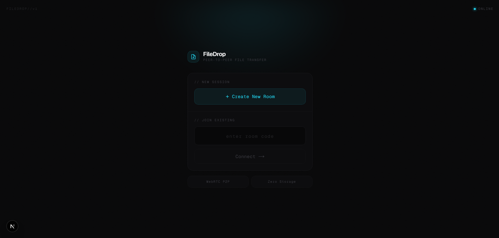
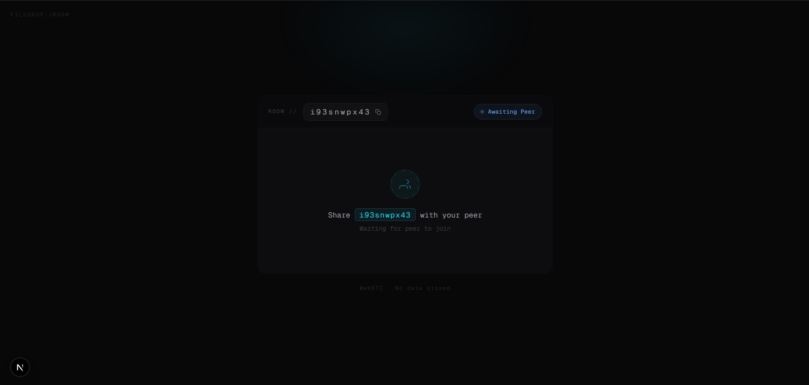
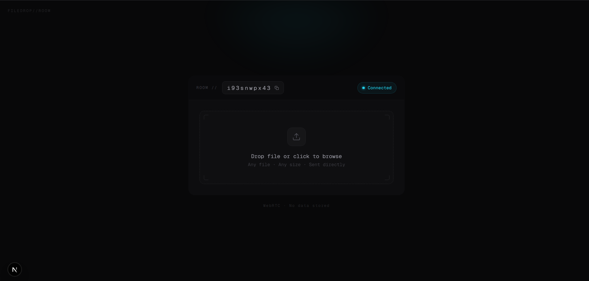
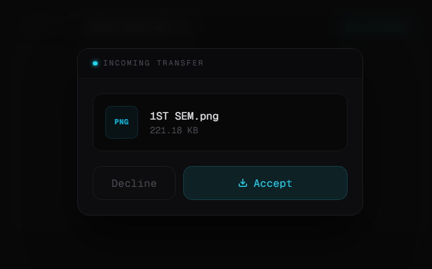
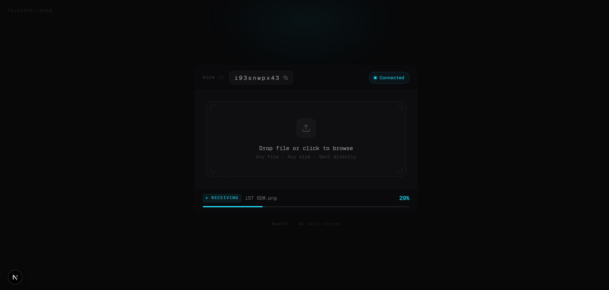

# 🚀 FileDrop - Peer-to-Peer File Sharing

FileDrop is a high-performance peer-to-peer file transfer platform built using WebRTC, Next.js and TypeScript. It enables secure browser-to-browser file sharing without uploading files to any server.

No uploads. No cloud storage. No middleman. Just pure P2P transfer.

---

## 🌐 Live Demo

### Frontend

https://file-drop-inky.vercel.app/

### Backend

https://filedrop-production-b0ac.up.railway.app

---

## ✨ Features

- 🔗 Direct Peer-to-Peer File Transfer (WebRTC Data Channels)
- 📦 Chunked File Streaming (64 KB chunks)
- ⚡ Zero Server-Side File Storage
- 🧠 BufferedAmount Backpressure Handling
- 📊 Real-Time Upload & Download Progress Tracking
- 🧾 Room-Based Connection System
- 🧑‍🤝‍🧑 Secure Two-Peer Sessions
- ❌ Transfer Abort & Error Handling
- 📥 Native File Save Support
- 🚀 Fully Deployed & Production Ready
- 🌐 Browser-to-Browser Secure File Sharing

---

## 🏗️ Project Architecture

```text
                     +----------------------+
                     |      Frontend        |
                     |      Next.js         |
                     |   (Hosted on Vercel) |
                     +----------+-----------+
                                |
                                |
                                v

                     +----------------------+
                     |   Signalling Server  |
                     |   Node.js + WS       |
                     | (Hosted on Railway)  |
                     +----------+-----------+
                                |
                        SDP Exchange Only
                                |
                                v

                     +----------------------+
                     |      WebRTC P2P      |
                     | Browser <--------> Browser
                     +----------------------+
                                |
                                v

                     Direct File Transfer
                    (No Files Stored Anywhere)
```

---

## ⚙️ How It Works

1. User creates a room (random 10-character room ID).
2. Another user joins using the same room ID.
3. The signalling server exchanges SDP offers and answers.
4. WebRTC establishes a direct peer connection.
5. Files are split into 64 KB chunks.
6. Chunks are streamed over WebRTC Data Channels.
7. Receiver writes files directly to disk.

> The signalling server is ONLY used to establish the connection. No file ever passes through the server.

---

## 🏗️ Tech Stack

### Frontend

- Next.js (App Router)
- TypeScript
- Tailwind CSS
- Framer Motion

### Backend

- Node.js
- Express.js
- WebSocket (ws)

### Core Technologies

- WebRTC
- RTCPeerConnection
- RTCDataChannel
- Streams API
- StreamSaver.js

### Deployment

- Vercel
- Railway

---

## 📸 Screenshots

### Home Page



---

### Waiting For Peer



---

### Connected Session



---

### Incoming File Request



---

### File Transfer Progress



---

## 📁 Project Structure

```text
FileDrop
│
├── client
│   ├── app
│   ├── components
│   │
│   ├── hooks
│   │   ├── useWebRTC.ts
│   │   └── useFileTransfer.ts
│   │
│   └── public
│
├── Server
│   └── server.ts
│
└── screenshots
```

---

## 🚀 Getting Started

### Clone the Repository

```bash
git clone https://github.com/girish-xd/FileDrop.git
```

---

### Setup Backend

```bash
cd Server
npm install
npm run dev
```

Server runs on:

```text
http://localhost:1908
```

---

### Setup Frontend

```bash
cd client
npm install
npm run dev
```

---

## 🔐 Environment Variables

Create a `.env.local` file inside the client directory.

```env
NEXT_PUBLIC_BACKEND_URL=http://localhost:1908
```

For production deployment:

```env
NEXT_PUBLIC_BACKEND_URL=https://filedrop-production-b0ac.up.railway.app
```

---

## 🧪 How To Use

1. Open FileDrop on two devices.
2. Click Create Room.
3. Share the room ID.
4. Join the room from the second device.
5. Select or drag & drop any file.
6. Accept the transfer request.
7. Download completed. ✅

---

## ⚠️ Limitations

- Supports only two peers per room.
- WebRTC connectivity depends on network conditions.
- Extremely large file transfers depend on bandwidth and browser limitations.

---

## 💡 Future Improvements

- Multi-peer file sharing.
- Resume interrupted transfers.
- End-to-end encryption layer.
- File previews.
- Mobile-first optimizations.
- QR-based room sharing.

---

## ⭐ Support

If you liked the project, consider giving it a star.

---

<div align="center">

### Built after sacrificing sleep, sanity and several thousand AI tokens.🫩

##### by Girish Jain🩷

</div>
